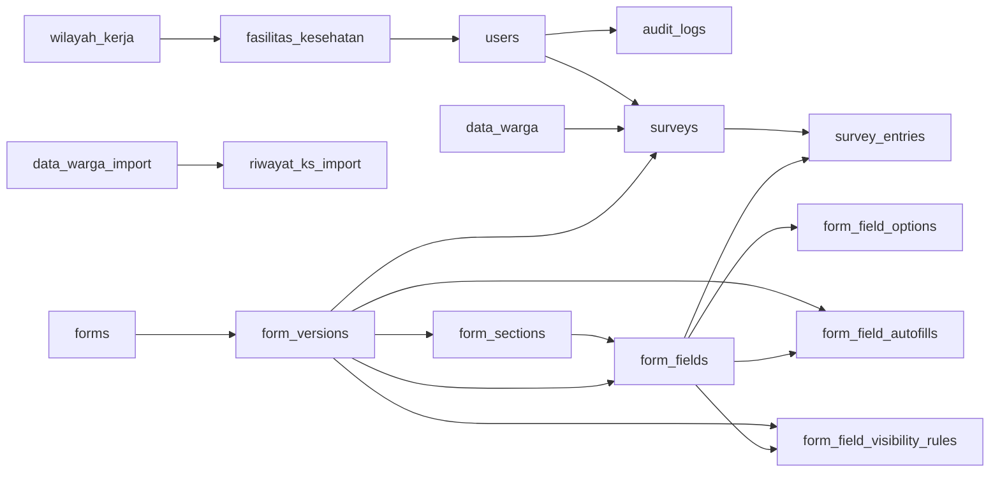

# Data Dictionary Database

Dokumen ini menjelaskan 19 tabel aplikasi di schema PostgreSQL `public`.
Introspeksi database yang dikonfigurasi pada 31 Oktober 2026 menemukan 59 tabel
di seluruh database; tabel di `auth`, `realtime`, `storage`, `vault`, dan
`drizzle` merupakan infrastruktur Supabase atau Drizzle dan tidak dikelola sebagai
schema fitur aplikasi.

## Peta Relasi

## Data Referensi dan Impor

| Tabel                 | Fungsi                                                                                      | Relasi dan catatan                                                                            |
| --------------------- | ------------------------------------------------------------------------------------------- | --------------------------------------------------------------------------------------------- |
| `wilayah_kerja`       | Daftar kecamatan/kelurahan yang dilayani.                                                   | Induk `fasilitas_kesehatan`.                                                                  |
| `fasilitas_kesehatan` | Fasilitas Posyandu/Pustu dan alamatnya.                                                     | Memiliki `wilayahKerjaId`; menjadi induk `users`.                                             |
| `users`               | Daftar kader/petugas yang dapat dipilih sebagai pencatat. Bukan tabel akun login per orang. | `fasKesId` menunjuk fasilitas; direferensikan oleh `surveys`, `data_warga`, dan `audit_logs`. |
| `data_warga`          | Data warga yang telah dimasukkan ke sumber data utama aplikasi.                             | `surveys.wargaNik` menunjuk NIK di tabel ini.                                                 |
| `data_warga_import`   | Data hasil impor yang dipakai untuk pencarian dan pemilihan sasaran.                        | Sumber `riwayat_ks_import`; masih dipakai oleh `sasaran.server.ts` dan resolver opsi.         |
| `riwayat_ks_import`   | Jawaban riwayat kesehatan keluarga yang berasal dari impor.                                 | `raw_id` terhubung ke `data_warga_import.raw_id`.                                             |

## Definisi Form dan Rules Runtime

| Tabel                         | Fungsi                                                | Relasi dan catatan                                                        |
| ----------------------------- | ----------------------------------------------------- | ------------------------------------------------------------------------- |
| `forms`                       | Identitas form, termasuk form bawaan.                 | Induk `form_versions`.                                                    |
| `form_versions`               | Draft, versi terbit, dan riwayat versi definisi.      | Menunjuk `forms`; versi yang dipakai submission ditautkan dari `surveys`. |
| `form_sections`               | Urutan dan metadata section pada satu versi.          | Menunjuk `form_versions`; menjadi induk field.                            |
| `form_fields`                 | Definisi field, tipe, label, urutan, dan sumber opsi. | Menunjuk section dan versi form; dipakai runtime dan validasi.            |
| `form_field_options`          | Pilihan statis milik field.                           | Dihapus bersama field melalui foreign key cascade.                        |
| `form_field_autofills`        | Aturan pemetaan/autofill untuk versi form.            | Dibaca dan ditulis oleh Form Builder serta runtime extension.             |
| `form_field_visibility_rules` | Aturan tampilan field/section untuk versi form.       | Dibaca dan ditulis oleh Form Builder serta runtime extension.             |

Rangkaian utamanya adalah `forms → form_versions → form_sections → form_fields`.
Opsi dan aturan runtime terhubung ke definisi field/versi form. Walaupun tabel
rules dapat kosong ketika admin belum membuat aturan, tabelnya tetap bagian dari
fitur dinamis dan tidak boleh dihapus hanya karena belum berisi baris.

## Submission, Audit, dan Operasional

| Tabel                | Fungsi                                                                         | Relasi dan catatan                                                            |
| -------------------- | ------------------------------------------------------------------------------ | ----------------------------------------------------------------------------- |
| `surveys`            | Header setiap pengisian form: versi, petugas, tanggal, dan warga bila berlaku. | Menunjuk versi form, `users`, dan opsional `data_warga`.                      |
| `survey_entries`     | Nilai jawaban per field.                                                       | Menunjuk submission dan field; satu baris per pasangan submission/field.      |
| `audit_logs`         | Jejak tindakan perubahan data/form untuk pemeriksaan.                          | `userId` boleh null agar jejak tetap ada ketika pengguna tidak tersedia.      |
| `valid_session`      | Token sesi login yang masih berlaku.                                           | Data operasional; sesi kedaluwarsa dibersihkan oleh alur autentikasi.         |
| `pin_attempts`       | Percobaan PIN per alamat IP untuk rate limit.                                  | Data operasional; tabel kosong bukan alasan untuk menghapus perlindungan ini. |
| `push_subscriptions` | Endpoint subscription notifikasi push.                                         | Hanya dapat dipensiunkan bersama fitur dan alur notifikasi push.              |

## Batas Data Lama Form Kunjungan Rumah

Submission kunjungan rumah mempertahankan payload JSON legacy `record_legacy`
dengan `schemaVersion: 17`. `surveys` dan `survey_entries` menjadi penyimpanan
generik yang menunjuk versi/field form; pengorganisasian tabel tidak mengubah
bentuk payload legacy tersebut.

## Pengelolaan Schema

- Definisi tabel aplikasi berada di `src/lib/schema/schema.ts`,
  `src/lib/schema/data-import.ts`, dan `src/lib/schema/type-enum.ts`.
- `drizzle.config.ts` menggunakan glob ketiga file itu dan membatasi Drizzle Kit
  ke schema `public`. Jangan ganti glob menjadi satu file: tabel impor dan enum
  juga bagian dari definisi aplikasi.
- Tabel `auth`, `realtime`, `storage`, `vault`, dan tabel migrasi Drizzle
  dikelola layanan/platform. Jangan menghapusnya untuk merapikan daftar tabel.
- Sebelum perubahan schema: jalankan `pnpm db:sql`, periksa SQL yang dihasilkan,
  lalu ikuti alur migrasi yang sesuai. `pnpm db:push` hanya untuk development
  setelah rencana perubahan dan target `DATABASE_URL` diverifikasi.
- Tabel impor hanya boleh dipensiunkan setelah data, pencarian sasaran, dan
  autofill yang bersumber darinya telah dipindahkan dan diverifikasi. Belum ada
  migrasi pemindahan/penghapusan yang aman untuk dijalankan saat ini.
